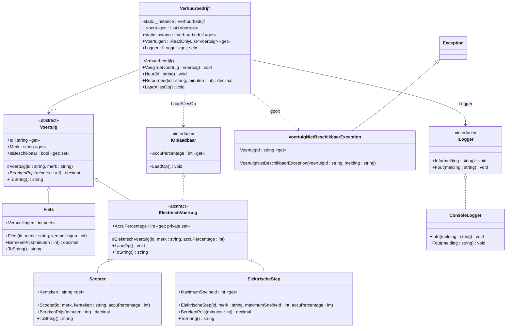

# UML-cheatsheet

## Notatie

| Symbool | Betekenis |
|---|---|
| `+` | public |
| `-` | private |
| `#` | protected |
| `naam: type` | property/veld (type achteraan) |
| `Methode(param: type): returntype` | methode |
| `{get}` / `{get; set}` | read-only / lezen en schrijven |
| *cursief* of `{abstract}` | abstracte methode |
| `«abstract»` boven de naam | abstracte klasse |
| `«interface»` boven de naam | interface |
| onderstreept | static |

## Pijlen

| Relatie | Lijn | Pijlpunt | Voorbeeld |
|---|---|---|---|
| Overerving (`: Basis`) | doorgetrokken | holle driehoek naar de basisklasse | Fiets → Voertuig |
| Implementatie (`: IX`) | **gestippeld** | holle driehoek naar de interface | ConsoleLogger ⇢ ILogger |
| Associatie ("heeft") | doorgetrokken | open pijl (+ multipliciteit `0..*`) | Verhuurbedrijf → Voertuig |
| Afhankelijkheid ("gebruikt/gooit") | gestippeld | open pijl | Verhuurbedrijf ⇢ VoertuigNietBeschikbaarException |

## Het klassendiagram van stap 1 (Mermaid, rendert op GitHub)

## Waar ze op letten

- Alleen **echt nieuwe of overridden** leden in een subklasse tekenen. `LaadOp` en `AccuPercentage` staan dus alleen in `ElektrischVoertuig`.
- Singleton: private constructor, `static _instance`, `static Instance` (onderstrepen op papier).
- Constructor protected in een abstracte klasse: `#Voertuig(...)`.
- Op papier is zelf een nette tekening met correcte pijlen belangrijker dan een mooie tekening.
